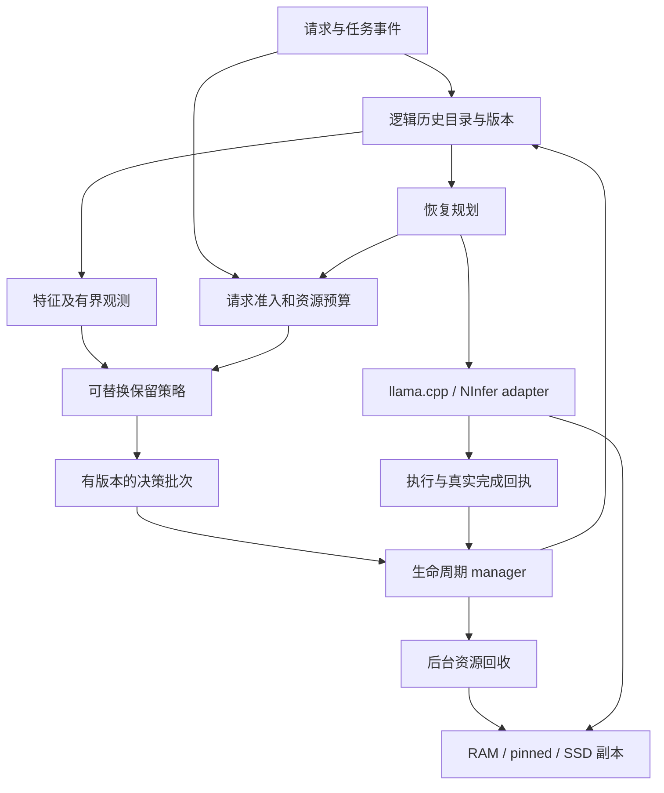

# 分离式 KV 生命周期管理系统设计与实施计划

日期：2026-10-31。状态：第一阶段基线与契约、第二阶段首批支持档位已落实，第三阶段开始梳理接线；TSan、完整生产及其他配置仍有未完成门槛，完整状态见 [六阶段进度](kv-lifecycle-progress.md)。

第一阶段已确定 NInfer 为主后端，固定版本、模型身份、首批支持档位并完成主机契约检查，见 [第一阶段基线](kv-lifecycle-baseline.md)。新基线已有公共 MemoryStamp、BlockDescriptor、CheckpointIdentity 和 HostKvStorage，后续在这些类型上扩展，不重复建设。下文保留原总体设计及其边界。

目标是把现有 CPU historical KV 后台回收，发展成能解释保留理由、区分淘汰与遗忘、控制资源预算、处理版本变化并支持有条件恢复的生命周期系统。继续复用已有 repository、lease、manager、策略和存储实现；优先统一行为契约和补齐恢复闭环，不重新编写一个通用推理框架。

这里的分离首先指 Active 与 Historical 的职责分离，以及策略与资源机制的分离。首期仍在现有单机后端内完成，不以新增跨机器 KV 服务作为前置条件。

## 1. 设计依据与当前基线

本次只读核对了两个已有工作树，未切换分支、未合并代码、未运行新模型验收。实现和测试结论必须继续按分支、二进制和运行配置归属。

- 当前工作树：`codex/background-gc-redundancy`，`be21a18e6141dbd4a6ff26d214e01903ffb947c3`。已有 HistoricalKvRepository、分资源 lease/release、请求预约、后台 GC、LRU/redundancy、decode 边界提交，以及 Mean-K/MTP 接线。当前还有不属于本提案的未提交实验文件，不能覆盖。
- 较新 NInfer 工作树：`codex/ninfer-gc-integration`，`a50789573e4ba43b137076c15b552d0e3a98e9ca`。已有 64-token page bridge、统一策略注入、原生 Host 容量观测、checkpoint 保护撤销、部分尾页特征失效和 MTP 验收。它与 llama.cpp 32-token 块路径不等价。
- 老师 2026-10-15 的参考文档保留为安全协议依据，尤其是代际身份、退休关闭新许可、已有操作继续、分资源回收和有界预算；其中“尚未实现”的基线说明已经过时。
- 最新截图中 P3 提出的重点是：区分语义过期和未来仍有用的历史，明确删除后恢复条件，定义最小元数据，并统计旧版本和失败轨迹的后续访问。这比仅实现 LRU 的范围更大。

当前已经具备的基础应保留：

1. `incarnation + slot + generation` 防止旧操作误用复用后的槽位。
2. `Ready → Writing → Live → Retired → Releasing → Ready` 与不可逆退休。
3. Host、packed K/V、Mean-K、NVMe/pinned、GPU/metadata 依赖分别结算的基础接口。
4. 策略只提出意图，manager 复核并提交，后台回收器释放资源。
5. off/shadow/delete 对照、真实释放与槽位 Ready 分开统计。
6. 生命周期、容量拒绝/恢复、模型、HTTP、Agent 与性能测试入口。

仍然需要系统化的部分：

- 稳定的逻辑历史目录、任务/版本语义、显式恢复能力与恢复计划。
- 跨会话及所有辅助结构的总预算，而非只限制历史 payload。
- llama.cpp 与 NInfer 的一致语义及明确能力差异。
- 删除原因和证据的结构化提交协议，而不只是日志中的解释。
- 缓存失配、版本变化、checkpoint 缺页后的可预测处理。
- 稳定的研究与生产验收，尤其是多次回收后的长任务质量。

不能把历史失败直接当作当前缺陷：llama.cpp 的早期 Agent 试跑出现过前缀失配与全量重建超容量，后续源码已有有界尾部空白兼容；是否覆盖全部情况仍须验证。早期 redundancy 的相似关系传递反例，当前源码已改为直接 witness，不应再次安排“从零实现直接代表”。NInfer 最终版本已有同一 COBOL 任务 off/LRU/redundancy 全部 reward 1.0 的记录，并非尚无真实 Agent 成功；单次结果仍不能代表总体质量。

## 2. 对外要区分的四种操作

### 2.1 释放副本 EvictReplica

归还某一份物理 KV，例如释放 RAM 副本、保留经校验的 SSD 副本。逻辑历史仍允许后续使用，读取时可以从合法副本恢复。释放前必须确认替代副本已经提交，或者该历史明确允许按恢复计划重算；不得先删除唯一副本再假设写盘成功。

现有 repository 退休会关闭新的历史使用入口，因此不能直接用它冒充“只换出一个副本”。应复用它的 ownership 原语，并在副本层增加独立状态。

### 2.2 退出后续召回 RetireHistory

让某段历史不再取得新的执行/搬运许可。它可以仍有正在完成的 GPU 操作，也可能在源记录中保留原始 token，但不再自动参加历史召回。CPU 资源在真实依赖退出后释放。

这最接近当前 delete 模式的语义。退休不能通过旧 checkpoint、旧查询缓存或后台写回被撤销。若要重新引入，必须执行显式恢复事务、重新准入并建立新的身份/版本，记录恢复来源和原因。

### 2.3 作废派生版本 InvalidateDerived

输入前缀、模型、位置布局或相关状态变化后，某些 KV/特征不再适用。它不是“这个事实没用了”，也不是普通 LRU 淘汰。先关闭复用入口，再按依赖范围失效和回收。

修改早期输入通常会影响后续计算，不能只换掉被修改块；保留到经过证明的公共边界，从合法 checkpoint 重算受影响的后缀，或开启新的计算分支。

### 2.4 永久遗忘 ForgetSource

删除原始恢复依据、归档及其可恢复别名，明确放弃恢复承诺。它应由独立的数据保留规则或用户请求触发，不能由普通内存压力隐式触发。

首期自动策略只处理副本淘汰与历史退休；永久遗忘作为单独接口和配额规则。它不默认意味着底层存储达到取证级安全擦除。

## 3. 最小可行架构

这些是逻辑职责，不要求七个线程或七个新框架。首期沿用已有工作线程；昂贵评分与回收争用明显时再用固定容量 mailbox 分离。

- **逻辑目录**回答：这是哪段历史、来自哪个任务/版本、当前是否可选、有哪些合法副本和恢复依据。它不是 KV 内存地址表。
- **策略**回答：保留、降级、退休哪个对象，理由、优先级及需要的证据是什么。策略不 free，不改 GPU 工作集，不等待磁盘/网络/模型调用。
- **manager**验证代际、版本、策略条件和预算状态，提交可见性变化，处理重试与结果确认。
- **reclaimer**只看实际资源权利和完成状态，推进幂等释放，不判断任务语义。
- **预算协调**管理真实可用 bytes/slots、请求预约、恢复空间、旧域和辅助结构；pending 只是计划量。
- **恢复规划**判断能否复用、读盘、回放或重新计算，先形成可审查的计划并预约，再执行。
- **backend adapter**定义真实执行窗口、提交/完成点、checkpoint、main/draft/recurrent 状态与物理记录移交。

首期不统一各后端 allocator。先用一致的事件、身份、能力声明和契约测试，让已有原生实现承担其实际 ownership。

## 4. 身份与最小元数据

### 4.1 保留两层身份

逻辑历史身份不依赖 RAM 槽位。建议由 `session_id + timeline_id + span_id` 标识，携带原始 token/row 区间；分支、前缀修改和重新计算必须能辨认。

物理身份继续使用现有 `incarnation + slot + generation`，每份 allocation 再有自己的 allocation generation。逻辑 span 可以对应多个物理块；物理块跨消息边界时保留区间映射，不伪造单一角色标签。

一次恢复、truncate 或 branch 可以替换物理身份，不能改变原始位置含义。目录、异步任务、checkpoint 和决策只使用带版本身份，不长期保存可复用槽位的裸指针。

### 4.2 必需字段

1. 来源：会话、timeline、原始区间、消息/工具事件 ID、已接受内容的摘要。
2. 计算兼容性：model/weights/LoRA、tokenizer、chat-template、RoPE/位置、KV dtype/layout、backend ABI，以及 main/draft/recurrent 状态版本的配置 ID。
3. 生命周期：可见性版本、内容版本、退休原因与提交序号、物理 generation。
4. 资源：RAM/SSD/特征副本位置、bytes、状态、校验值、完成/依赖标记。
5. 恢复：仍有效的 checkpoint/source 引用、恢复模式、依赖范围、估算工作量。
6. 策略观测：真实执行最近使用、访问次数/衰减值、角色与阶段来源、任务锚点、特征 schema 和 Query epoch。

大配置、角色文本和完整依赖图不要逐块复制；以 session/timeline 级表和整数 ID 引用。首版用区间依赖与 checkpoint 边界，不建设任意粒度的全历史 DAG。

退休记录本身也不能无限增长。只有仍可能被合法句柄、checkpoint 或恢复清单引用的身份，才需要逐项保留；过期引用被 timeline/version fence 整体拒绝后，可压缩或清理旧记录。源记录与研究访问日志有独立配额/期限，不能因为 KV 数据有界就默认这两个结构有界。

### 4.3 哪些边界必须作废

- 模型/布局等不兼容：拒绝 KV 直接复用；保留原始记录时可生成新的计算域。
- 前缀改动：按公共 token/row 边界和 checkpoint 覆盖计算影响范围；不能只比较可见文本。
- partial-tail truncate：失效尾页 descriptor、Query 观测和 speculative 后缀，完整前缀页继续保留。
- 任务状态或外部文件版本改变：先让相关“可复用证据”失效。已运行工具的输出仍是过去事实，不自动删除整段对话。
- restore/attach：校验 manifest、当前退休/遗忘记录、依赖覆盖及能力，不能仅凭文件存在认定可恢复。

NInfer 已有 partial-tail 特征失效回归，应迁入共享契约用例；不重复创建另一套规则。

## 5. 状态与并发协议

### 5.1 三条独立状态轴

- 逻辑资格：Eligible / Retired / Invalidated。Retired 对该身份不可逆。
- 每份物理副本：Absent / Preparing / Valid / Evicting / Releasing。Preparing 不计为可读替代副本。
- 恢复能力：ExactSnapshot / ReplayPlan / RebuildAsNew / Unavailable，附带兼容条件和成本。

现有 Ready/Writing/Live/Retired/Releasing 继续描述 repository 槽位。不要把所有轴组合成几十种大枚举；以明确的状态不变量连接。

### 5.2 退休与执行

保留“旧许可继续，新许可关闭”的机制。每个新 Query/reselect/attach/恢复必须建立新的执行许可；已有窗口只能覆盖事先定义的范围，不能无限续期。

保留现有 decode 边界逻辑提交作为首个支持模型：后台准备意图，在下一次新选块之前以有界批次提交，物理释放独立进行。GPU 仍在执行时不修改已提交指针。边界不等于必须同步整个 GPU。

**边界提交的无等待承诺需要改造。** 当前 `HistoricalKvGc::commit_at_decode_boundary()` 使用 `std::lock_guard(pending_mu_)`，并经 `commit()` 调用 `policy_->permits()`。即使 worker 只短暂持锁，前台仍可能等待，也仍在执行策略虚函数。目标改为预分配的单生产者/单消费者批次交接和有界条件检查；评分、排序、特征读取与日志留在后台。批次未就绪则跳过本次提交；有效命令保留，不丢弃，不借此等待策略。先验证协议和进展，不宣称无硬件争用或硬实时。

条件退休不要求全窗口原子快照。涉及多对象证据的决策由单一退休 owner 在提交边界串行验证；内容可变时使用已有可线性化版本协议，不能靠“先读版本再独立 CAS”掩盖竞态。

### 5.3 两个后端的能力差异

llama.cpp 的基础 repository 能退休 Writing/active，旧权限保护实际使用；NInfer page bridge 当前只注册 sealed page，并保护 current view、media、in-flight 页。二者都可以作为明确声明的支持档位，不能写成同样的任意块退休能力。

目标系统允许生命周期机制支持更广泛的退休，但 backend 若不能把 GPU 权利、后续 Host 依赖和 metadata 独立表示，就继续报告当前档位。扩展 NInfer active/Writing 退休时必须先增加真实资源许可，不可直接删除保护判断。

### 5.4 物理释放与故障

读者、writer、H2D/D2H、NVMe IO、已承诺 rollback 分别结算。GPU-only 操作没有未来 Host 依赖时不阻止 CPU 副本释放；但它不能在 Host 已释放后升级为 Host reader。

释放中断时保存分资源完成位，重试不重复归还。回收先于新评分调度；策略停用、无候选或异常不应阻止已退休资源结清。队列仅为通知，权威状态可通过有界扫描恢复。

工作线程意外退出要显式发布 unhealthy；受影响域停止新接纳，已有执行按其真实依赖结束，转入已定义的清理或隔离路径。不能把“停止策略产出”混同“整个回收服务仍健康”。

## 6. 保留策略与任务语义

### 6.1 将候选资格、价值排序和动作选择分开

先保留三个可解释基线：LRU；现有 redundancy；推荐新增的带衰减访问价值。角色和任务阶段作为输入，首期不引入训练模型、在线 LLM 评分或复杂自适应参数。

候选资格由显式策略配置决定；生命周期机制只约束内存安全和版本有效性。用户/系统/工具返回默认更保守，但不是永久不可释放；如果保护集合本身超出容量，应选择归档、合法重建或拒绝，而不是无限保护或暗中突破规则。

动作按代价区分：优先移除昂贵可重建副本，必要时迁到 SSD；最后才在允许有损的策略档位退休逻辑历史。迁移不自动解决 SSD 配额，重算也不是免费空间。

### 6.2 最小任务语义

保留任务约束、已确认事实、当前有效计划/决定、尚未解决的错误及必要工具结果的锚点。锚点来源必须记录：用户标注、结构化 Agent 事件或普通启发式推断；置信度不能混同。

“失败轨迹”“旧版本”“thinking”都不能直接等同垃圾。例如一次失败构建的错误码可能在十轮之后仍用于修复。只有已被明确替代/解决的证据，才获得更高淘汰优先级；没有结构化证据时退回可解释的访问/阶段信号。

锚点带 scope、版本与到期/解除条件，并计入配额。它提供保留偏好，不保证任意长任务的质量，也不能让所有模型输出被永久 pin。

### 6.3 冗余证据成为结构化输入

当前源码已有直接 witness 选择与 proposal 日志，但 `DeleteIntent` 主要携带 victim、round、reason、expected_content_version；代表身份和证据条件没有作为通用提交对象完整传递。

建议逐步扩展决策记录，显式携带 action、victim identity/version、策略/配置版本、Query epoch、reason，以及可选 witness identity/version、feature schema/score epoch。轻量条件使用固定格式；不要让前台再次运行任意策略代码。

在提交时验证该策略声明的 witness 仍合法且本批不同时退休；失效返回 Reevaluate。单一提交 owner 保护提交期间的顺序。相似度证据只支持“按该代理指标相近”，不能称为语义无损。跨轮后代表也可以被有损退休，但应记录保障撤销，不能借 A≈B、B≈C 宣称 A≈C。

### 6.4 原因与模式

建议分别记录 lru_pressure、feature_redundancy、lossy_capacity_fallback、semantic_superseded、replica_eviction、version_invalidated、explicit_forget。现有 enum 的兼容性需要迁移，不能只改日志名称。

off 不产生新策略动作，但完成已有清理；shadow 记录建议，不消费虚拟空位；delete 按显式动作契约执行。特征采集开销与策略执行开销分别测量，不能把同样采集特征的 off 叫作原始 llama.cpp 基线。

## 7. 恢复系统与前缀兼容

### 7.1 每次恢复先生成计划

恢复请求返回五类结果之一：兼容副本直接载入；合法 checkpoint 加回放；从源记录开启新域重建；等待准入；不可恢复并说明原因。计划包括目标 timeline、可用依赖、空间/IO/计算估计、执行边界和允许的语义变化。

执行前取得恢复 scratch、目标副本和中间状态预算。成功后再原子发布新目录；失败保留原可服务域或明确隔离失败域，不能发布半恢复状态。

### 7.2 原始文本存在，不代表旧 KV 可以原样补回

某块 KV 取决于其计算上下文、位置、模型和之前执行的历史选择。只重新输入该块 token 通常不足以复原旧 KV。

- 精确副本恢复需要相同计算身份和完整性校验。
- 同一稀疏执行语义的回放，可能需要 checkpoint、实际使用上下文及选择决策记录；执行谱系也有容量成本。
- 直接从完整 transcript 重新 prefill 可以定义为新的 canonical 计算域，但不能暗中当作原稀疏 KV 的逐位恢复。
- 硬件/数值实现变化时，不承诺逐位一致；区分身份/语义兼容和数值一致性测试。
- 缺少必要状态或重建工作集超出配置时，明确拒绝该恢复档位。分块读取文本不能自动消除完整 attention 的状态需求。

首期先交付源记录驱动的受控新域重建和已验证 checkpoint 恢复；不承诺任意稀疏执行轨迹的精确回放。

### 7.3 源记录与 checkpoint

源记录保存实际接受的 token/row、消息边界、工具输出及模板/模型配置 ID；工具恢复使用保存结果，不重新执行有副作用的外部命令。多模态则还需对应不可变资产及映射，未具备时拒绝该恢复能力。

checkpoint 使用稀疏 manifest：覆盖区间、计算身份、recurrent/main/draft 状态、所需资源/源记录及删除可见性版本。未来复用的闲置 checkpoint 不得永久 pin 住整个历史；其依赖被退休时撤销所有别名或降级为重建入口。已经开始的 restore/rollback 取得有限、真实的依赖权利。

持久化首版保存完整 checkpoint 与源记录边界，校验后以 manifest 提交点发布；未完成对象不可见。进程崩溃只恢复最后已提交边界，不承诺逐 token 持久化。逻辑遗忘记录和 timeline fence 在载入时优先检查，旧归档不能绕过已声明的遗忘规则。

### 7.4 前缀复用

token/row 序列是复用依据，规范化文本是辅助输入。先校验模板和计算身份，再找公共前缀和合法 checkpoint；原始生成 token 与下一轮重新渲染结果之间的差异必须可追踪。

当前有界尾部空白兼容应保留为显式适配规则，并补模板/分词边界反例。不能一般性忽略空白或吞掉任意前缀差异。真正分歧时，从经过验证的边界恢复；计划放不下则在执行前返回明确状态，而不是反复请求一个必然超过总容量的 reset。

## 8. 全局预算与容量不足

### 8.1 分资源计账

至少覆盖 Host payload、pinned/staging、特征与 Query、目录/版本/锚点、决策与事件、旧域/cleanup、checkpoint、源记录、SSD extent/IO。各资源池保留 allocated、reserved、in-flight、retired-pending、reusable 等互斥或明确重叠的口径。

只有真实 reusable 容量用于新准入。一个逻辑块被多个资源副本引用时，各副本分别记真实 bytes；同一 allocation 的多个引用不得重复计费。Host 早释和完整槽位 Ready 继续分开。

审计优先检查当前范围容器、观察历史、特征缓存和 archive alias：按物理容量分配的表不等于按会话累计增长的 span 向量天然有界。对每个结构声明 owner、上限、回收点、溢出行为。

内存上界分两层：系统自有资源给出可核算预算；进程 RSS/GPU 驱动保留等报告实测峰值及边界。不能把所有推理框架临时分配的重写作为本系统交付前提。

### 8.2 两种准入档位

**严格请求档位：** 在 active 前预约有限请求最坏资源，包括尾块切换、main/draft、在途副本和 rollback。已接纳请求不依赖 GC 持续供给。首先对应已有 llama.cpp 有限请求路径。

**分块服务档位：** 按 prefill chunk 或可声明的执行边界取得资源，有界等待回收/迁移，超时结束或拒绝；必须记录等待，并明确不保证全请求无需补给。NInfer 当前 prefill 最多等待两秒且紧急路径可在前台归还已 detach owner，属于这个档位的现实差异。不能把该路径写成“所有物理释放均在后台、前台绝不等待”。

默认新接口使用严格档位；已有 NInfer 档位保留并明示。若要给 NInfer 提供严格档位，另做真实预约接线及尾页最坏需求验收，不能仅靠水位调整宣称完成。

### 8.3 空间不足的固定升级顺序

1. 在预算内推进已退休对象释放，诊断 reader/IO/旧域停滞。
2. 淘汰可重建昂贵副本，按配置迁移已验证冷副本至 SSD。
3. 在显式允许有损的范围内按策略退休历史，并扣除已计划释放，避免过量删除。
4. 入口排队/限流或分块档位有界等待；每个等待均有取消、超时和配额。
5. 无合法空间、源记录/SSD 配额也不足时拒绝、结束会话或由上层选择摘要新分支；不静默遗忘受保护数据。

摘要如果未来接入，必须是显式变更历史语义的新分支/事件，不作为本期 GC 的隐式内存压缩动作。

有限资源、永久保护和无限历史无法同时保证；产品需公布保留期限、总配额和可恢复期限。

## 9. 实施顺序与每阶段完成条件

所有阶段先在一个主后端跑通，再用同一契约覆盖第二个；不把所有组合同时作为第一版开工条件。建议以已有较新 NInfer 分支作为服务接入主候选，llama.cpp repository 路径继续作为完整 lease 语义和回归参考。最终主干选择在第一阶段按维护状态确认，不在设计阶段自动合并几百个跨分支改动。

### 阶段 A：基线与契约

- 冻结代码/模型/原生后端 patch manifest、主后端、支持矩阵和性能方法。
- 为上述四种动作、Active 边界、严格/分块档位、失败码写契约。
- 对当前行为做差异测试，标记已支持、实验性和拒绝项。
- 完成条件：一份可运行契约集合和资源清单，旧证据按版本归属；没有“所有后端都已支持”的隐含承诺。

### 阶段 B：可靠机制与预算

- 改造 decode 边界批次交接，消除对 worker mutex 的等待与任意策略回调。
- 将必要证据、版本与原因纳入可提交决策；保持旧策略可兼容迁移。
- 完成辅助结构/旧域预算、worker 健康、容量不足/取消/失败的行为。
- 完成条件：退休/复用竞态、队列饱和、停止/异常、尾块碎片化、资源故障注入通过；按档位验证前台无 GC 等待或有界等待。旧 handle 不可能授权新代，释放只计一次。

### 阶段 C：恢复与版本闭环

- 实现最小逻辑目录、源记录/边界和 recovery planner。
- 接通精确前缀、真实前缀分歧、partial-tail、checkpoint 失效、reset/attach 的事务。
- 先交付 RAM 与受控新域重建，再加入 checkpoint 落盘/载入；区分在线恢复和进程崩溃恢复。
- 完成条件：实际删除后仍能按声明模式恢复；恢复拒绝可解释；旧快照无法复活已退休身份；缺页、损坏、模型变化、恢复 OOM 均不发布半成品。

### 阶段 D：任务感知保留

- 用结构化事件接入角色、任务阶段、已被替代/已解决状态和有限锚点。
- 保留 LRU/redundancy 基线，增加一种低成本衰减价值策略；策略组合顺序和有损兜底显式配置。
- 增加旧版本、已失败方案与其后续再访问的记录；仅凭访问未发生不能证明未来无用。
- 完成条件：有区分性反例、原因/证据审计、固定轨迹决策对照和实际任务结果。不能用“命中率高”替代任务质量。

### 阶段 E：分层存储与多会话

- 复用现有 NVMe/pinned/Host storage 组件，补公开参数、真实副本迁移、校验和失败回退。
- 首先允许一个运行会话加有配额的冷会话，再扩到多个运行会话和公平调度。
- checkpoint、源记录与 SSD 总配额一并生效，跨会话共享副本以 allocation owner 统一计费。
- 完成条件：RAM/SSD 均耗尽、磁盘错误、并发 reader、会话驱逐/恢复可预测；单会话不能绕过总预算。多 lane/MTP/混合状态逐项通过能力组合，不能因单项存在就承诺任意组合。

### 阶段 F：生产与研究验收

- 先用事件回放/故障注入验证安全，再做固定工作量性能；策略效果使用真实闭环 Agent。
- 以支持配置完成长时间、内存边界、持续换窗、多次 CPU 回收后继续工具使用与恢复。
- 同一机制下比较 off/LRU/redundancy/新增策略；固定预算、工具环境与 Harness，预先选任务和重复次数，报告失败而不筛选。
- 完成条件：支持矩阵、可复现脚本/版本、资源账本、任务/性能报告、已知问题和回退方式齐全。部署默认值只能来自已经验收的配置。

阶段 A–C 构成“生命周期闭环”的第一版；D 提供任务感知的研究贡献；E 补齐系统覆盖；F 是各支持组合对外宣布完成的门槛。每阶段保留独立交付物，不以一个含糊的总百分比代替完成条件。

## 10. 验收与研究问题

安全要求是硬条件：无 UAF、跨代污染、旧快照复活、重复归还和错误复用；故障时允许明确拒绝。内存检测、并发检测和真实 CUDA 验收互不替代。

性能至少分开报告：策略计算与特征采集、边界提交、准入等待、TTFT/prefill、普通单步 decode、MTP 验证轮与 token 输出、恢复延迟。已有 p95 增加不超过 5%、吞吐下降不超过 3% 可作为待重新冻结的工程目标；它不构成所有负载的硬实时承诺。详细审计开关与 GPU 放置/频率等实验条件必须记录。

机制成本用固定 token/工作量衡量；策略质量用在线 Agent 闭环衡量。不同策略生成轨迹改变后，总任务耗时包含思考量/工具调用量，不能直接解释为 GC 执行开销。

至少有以下区分性任务：

1. 多轮后回看早期约束或工具错误；失败轨迹中仍有关键线索。
2. 文件/用户要求更新使旧结论过期，区分“旧事实曾发生”和“当前仍有效”。
3. 三块相似链 A–B–C、代表后来失效、证据跨轮过期及容量兜底。
4. 同一逻辑历史超过 RAM 物理容量、发生多轮换窗后仍继续任务。
5. 前缀分歧、truncate 到 partial-tail、checkpoint 缺页与会话重载。
6. 读者/DMA 延迟、SSD 故障、所有候选受保护和恢复预算不足。

新增低成本访问事件用于回答老师截图中的问题：请求的是旧版本还是当前版本、失败/完成轨迹多久后再次用到、retire 后产生多少 miss、恢复是否成功以及成本。事件有总预算；已永久遗忘或抽样丢失的内容只能报告未知，不能统计成“从未需要”。

研究评价同时回答三个问题：省了多少真实资源；是否减少过期信息干扰；会不会删掉未来所需证据。单看 Ready、相似度或短窗口输出相同都不足以回答后两项。

## 11. 相对旧方案的保留与调整

保留：精确代际、许可与实际资源分离、退休不可逆、CPU 后台释放、策略可替换、有界工作量与真实容量预约。

调整：

- 从统一 DeleteIntent 演进为少量显式动作，不再混同副本淘汰与历史退出。
- 将任务语义、版本与恢复作为第一等接口，补上老师截图所指的研究缺口。
- 不把默认 LRU 的候选偏好当作机制禁区，也不为了“任意退休”强行删除尚无独立权利表示的 NInfer active page。
- 将严格请求和现有分块接纳明示为两个档位，保留不同后端现实能力，不假装契约一致。
- 先做直接证据的提交验证和恢复闭环，再扩展策略；不重复实现源码已有的直接 witness/尾页修复。
- 从单一 payload 水位扩展到分资源账本，但不把重写全部推理框架内存分配当作 GC 前提。
- 从“所有历史永久保留/无限会话”改为明确配额与恢复期限；超出时有确定的用户可见行为。

## 12. 需要和导师对齐的三项产品选择

这三项不妨碍完成契约整理，可按以下建议形成第一版方案：

1. **默认恢复承诺：** 建议自动 GC 保留有配额的 token/事件源记录，承诺受条件约束的新域重建；不承诺任意旧 KV 逐位恢复。若研究只关心不可恢复有损退休，源记录也可只作评测旁路，但必须另立产品档位。
2. **任务语义来源：** 建议先接结构化 Agent/工具事件，加保守角色规则；不要求用户预先提供一个完整知识库或另训语义模型。
3. **第一版完成边界：** 建议 A–C 加固定单会话主后端验收作为首个完整闭环，D 作为研究主线，随后 E；不要求首发支持全部后端、所有量化、多模态与任意并发组合。

本轮交付的是重新设计及实施顺序，没有将总目标标记完成，也未修改主机设置。原始偶发 CUDA 错误仍按其实际诊断状态保留；新增设计不会自动关闭旧问题。DeepSWE 未因本方案被安装或配置，真实 Agent 验证可继续使用项目已有的 Terminal-Bench/Terminus 入口。

## 13. 核对入口

- 当前路径：`kvmem/include/kvmem/historical_kv_{policy,repository,gc,redundancy}.hpp`，`kvmem/src/host/historical_kv_gc.cpp`，`src/adapter/llama-memory-kvmem.cpp`，`tools/llama-kvmem-prefix.h`。
- NInfer 路径（上述独立工作树）：`kvmem/include/kvmem/historical_kv_page_gc.hpp`、`historical_kv_page_features.hpp`，`docs/ninfer-historical-gc-integration.md`。
- 本分支记录：[后台 GC 基本闭环](background-history-gc.md)、[参数与验收记录](background-gc-parameter-retest.md)、[测试交接](historical-gc-testing-handoff.md)、[两题 Agent 试跑](experiments/2026-10-25-terminal-bench-pilot/README.md)。旧文档按日期和配置理解，后续源码修复不能倒写成旧运行成功。

以上基线结论来自源码和已有运行记录的核对，本轮没有复测旧实验，也不把历史报告当作本设计已验收的证明。
